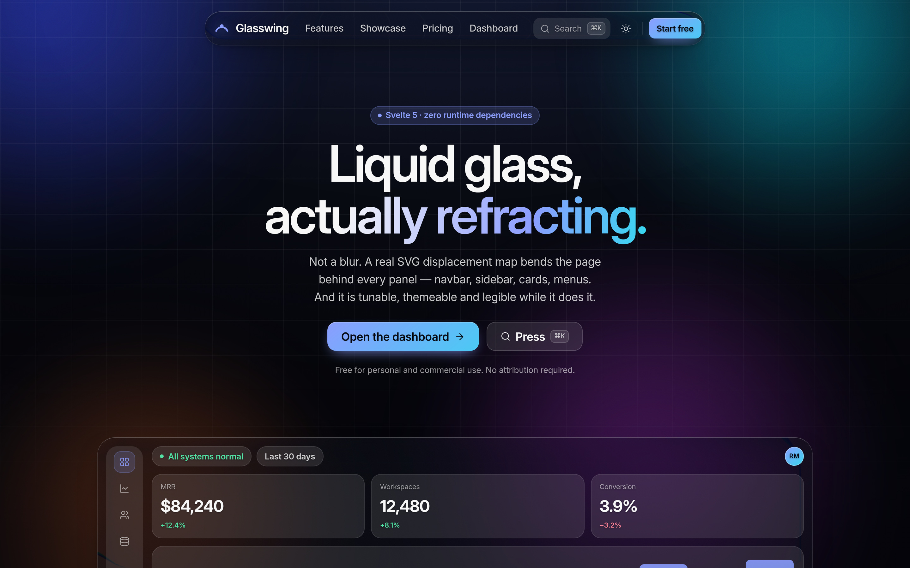
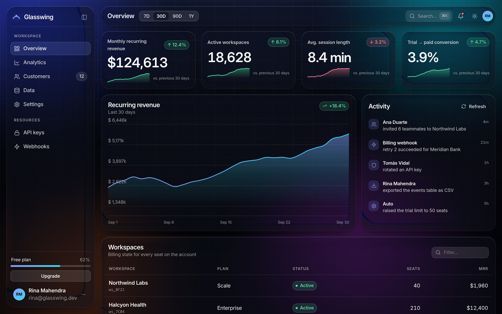

# Glasswing

A Svelte 5 SaaS template where every surface — navbar, sidebar, cards, menus, the command
palette — is **liquid glass**. Not a `backdrop-filter: blur()`. A real 2D refraction: an SVG
displacement map bends the page behind each panel, and three passes of it give the rim a
chromatic fringe.

Tunable from four numbers. Legible while it does it. Degrades honestly when it can't run.

```bash
npm install
npm run dev      # http://localhost:5173
npm run build    # static output in ./build
npm run check    # svelte-check
```

Zero runtime dependencies. Svelte, SvelteKit and TypeScript are dev-only.





---

## The three ingredients

| # | Ingredient | Lives in | Job |
|---|---|---|---|
| 1 | **Displacement map** | `buildMap()` in `src/lib/glass/glass.ts` | the per-pixel bend direction and magnitude |
| 2 | **Filter chain** | `<filter>` built by the `glass` action | applies the map, splits R/G/B, recombines, softens |
| 3 | **Host element** | `.glass-surface` in `src/lib/glass/glass.css` | clips to the shape, tints it, and keeps text out of the filter |

The long-form teardown — the neutral-point rule, the measured lens profile, every footgun —
lives in [`GLASS.md`](./GLASS.md).

### The one rule that matters

`feDisplacementMap` moves a pixel by `scale × (channel − 0.5)`. So **0.5 means "leave this
pixel alone"**. The whole design problem is painting a map that is exactly neutral except in
a band near the rim, where it ramps away from neutral.

The map is four shapes: a black base, a horizontal red ramp (the x lens), a vertical green
ramp (the y lens, `screen`-blended so it can only add G), and a blurred 50 % grey island
(the neutral zone). The island's blur *is* the lens rim.

---

## Using it

```svelte
<script>
  import GlassSurface from '#lib/glass/GlassSurface.svelte';
</script>

<GlassSurface preset="panel" class="my-card">
  <div class="glass-inner">…</div>
</GlassSurface>
```

### Props

| Prop | Default | What it does |
|---|---|---|
| `radius` | `20` | corner radius in px. **The action writes `border-radius` from this**, so the baked map and the CSS can never disagree |
| `band` | `'auto'` | width of the refraction band at the rim. `auto` = `clamp(min(w,h) × 0.16, 6, 18)` |
| `inset` | `0.035` | inset of the neutral island, as a fraction of height. Lower = stronger rim |
| `scale` | `-180` | bend strength in px. Negative = the backdrop is pulled inward at the rim |
| `chromatic` | `20` | spread between the red and blue passes. `0` disables the fringe |
| `alpha` | `1` | opacity of the neutral island. `1` is mathematically neutral in the centre |
| `vertical` | `true` | symmetric vertical lens (see *The blue-ramp fix* below) |

### Presets

`pill` (navbar, buttons) · `panel` (cards, popovers) · `window` (sidebar, large frames) ·
`chip` (small dense controls). A preset is just a default you can override prop by prop:

```svelte
<GlassSurface preset="window" scale={-190} chromatic={26}>…</GlassSurface>
```

The landing page has a live playground for all four numbers.

---

## Rules

These are the ones that bite.

1. **Never nest a glass surface inside another one.** `contain: paint` on the outer surface
   shrinks the inner one's Backdrop Root to the panel, so it refracts almost nothing, and you
   pay for two filter chains. Use siblings, or plain CSS for the inner highlight.
2. **Never put `filter`, `opacity < 1`, `mask`, `mix-blend-mode` or `will-change` for those on
   an ancestor of a glass surface.** Any of those makes the ancestor a Backdrop Root and the
   surface will only see itself. `transform` is fine — the navbar's hide-on-scroll uses it.
3. **The backdrop needs detail.** A displacement map is invisible on a flat colour — displace
   a uniform field and you get the same uniform field. `Aurora.svelte` deliberately carries a
   fine grid and film grain, because that is what makes the rim read as glass.
4. **The tint is painted on top of the refraction**, not below it. Changing `--gw-tint` changes
   the mood far more than changing `scale` does.
5. **The filter `<svg>` must stay in the DOM.** It is hosted at `opacity: 0`, never
   `display: none` — engine support for resolving `url(#id)` into a `display: none` subtree is
   inconsistent.
6. **Filter ids are document-global.** The action generates one per surface from a counter kept
   on `globalThis` so it survives HMR.

---

## The blue-ramp fix

The recipe this is built from painted its vertical ramp with **blue**. `feDisplacementMap`
reads the **G** channel, and blue's G is `0` everywhere — so the vertical ramp was inert, and
both rims dragged the backdrop the same way instead of opposing each other. GLASS.md §15.1
documents this.

Here the ramp is **lime at the top**, which does reach G, so the lens is symmetric: content
outside bleeds into the top edge and into the bottom edge, exactly as it does horizontally.
Combined with an opaque neutral island (`alpha: 1`), the interior of every panel is now
mathematically untouched rather than drifting a few pixels. Set `vertical={false}` to get the
original behaviour back.

---

## Legibility

The brief was "clear glass, but still readable", so contrast is treated as part of the
effect, not an afterthought:

- A tuned tint sits on top of the refraction in both themes.
- Every text node inside a surface carries `--text-shadow`, because the thing under it moves.
- All three text steps clear 4.5:1 against their tint in both themes.
- Semantic surfaces (danger, featured) use **theme-scoped** tokens (`--danger-tint`,
  `--accent-tint`) rather than hardcoded colours — a dark red tint reads as "dangerous" in dark
  mode and as an unreadable smudge in light mode.
- Verified against the brightest backdrop state the aurora produces.

---

## Performance

The expensive part is not the DOM. It is that `backdrop-filter` is re-evaluated on every frame
the backdrop changes — three displacement samples per pixel, per surface, at device pixel
ratio. Two escape hatches, both on **Settings → Appearance**:

- **Ambient motion off** — freezes the aurora, so filters only recompute when something else
  moves. Also honours `prefers-reduced-motion`.
- **Refraction off** — swaps the displacement filter for a plain `blur()` behind the same
  tint. Roughly a tenth of the cost per surface.

Engines without `backdrop-filter` fall through `@supports not` to a solid tint, so text stays
readable either way.

If you are running many surfaces on a weak GPU, remove `will-change: backdrop-filter` from
`glass.css` and use the `chip` preset for anything repeated.

---

## Browser support

`backdrop-filter` with an SVG `url()` works in Chromium and WebKit. Firefox supports it but has
historically been the flakiest of the three — verify before shipping. `@supports not` covers
the rest.

---

## Layout

```
src/
├── app.css                      design tokens, base layer, buttons, inputs, formatters
├── lib/
│   ├── glass/
│   │   ├── glass.ts             buildMap() + the `glass` action — the engine
│   │   ├── glass.css            the .glass-surface host
│   │   └── GlassSurface.svelte  the component you actually use
│   ├── components/              Aurora, TopNav, SideNav, MobileBar, AppTopbar,
│   │                            CommandPalette, StatCard, AreaChart, DataTable,
│   │                            ActivityFeed, GlassLab, Toggle, Segmented, Icon
│   └── state/                   prefs (theme / motion / refraction), palette
└── routes/
    ├── +page.svelte             marketing landing
    └── app/                     overview · analytics · customers · data · settings
```

Ships as a static SPA (`adapter-static`, `ssr = false`): the map is sized from a
`ResizeObserver`, so there is nothing useful to render on a server. Flip `ssr` on and add an
adapter when you outgrow it.

## Licence

MIT. Use it commercially, no attribution required.